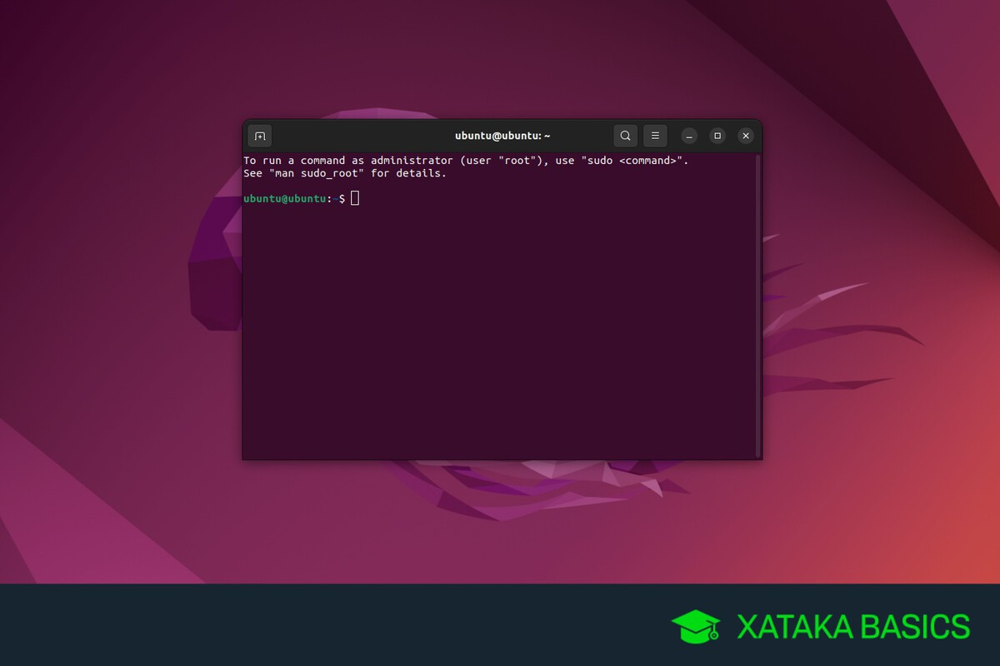

# Comandos básicos de Linux.


Este pequeño compilado ofrece informacion sobre algunos de los comandos basicos que se pueden usar en la terminal de Linux, desde la informacion general de archivos y directorios hasta permisos y configuracion basica

# Índice
1. [Introduccion a Linux y Shell](#1-introducción-a-linux-y-los-shells)
    - [1.1 ¿Qué es Linux?](#11-qué-es-linux)
    - [1.2 ¿Qué es un shell de Linux?](#12-qué-es-un-shell-de-linux)
2. [Requisitos](#2-requisitos) 
3. [Comandos basicos](#3-comandos-basicos)
4. [Referencias](#4-referencias)

# 1. Introducción a Linux y los shells
## 1.1 ¿Qué es Linux?

Linux es un sistema operativo, como macOS o Windows.

También es el sistema operativo de código abierto más popular, y te da mucha libertad.

Alimenta a la gran mayoría de los servidores que componen Internet. Es la base sobre la que se construye todo. Pero no sólo eso. Android está basado en (una versión modificada de) Linux.

El "núcleo" de Linux (llamado kernel) nació en 1991 en Finlandia, y ha recorrido un largo camino desde sus humildes comienzos. Se convirtió en el núcleo del sistema operativo GNU, creando el dúo GNU/Linux.

## 1.2 ¿Qué es un shell de Linux?
Un shell es un intérprete de comandos que expone una interfaz para que el usuario trabaje con el sistema operativo subyacente.

Permite ejecutar operaciones usando texto y comandos, y proporciona a los usuarios características avanzadas como la posibilidad de crear scripts.

## 2. Requisitos
- Computadora con Linux( o una maquina virtual)

- Consola terminal abierta en dicha maquina

- Idea clara de lo que quieres hacer

> Para que tu experiencia sea totalmente segura y no tengas problemas, ten en cuenta este único detalle técnico:
> - El peligro de `sudo`: La gran mayoría de los comandos de la recopilación se pueden probar de forma segura. No obstante, comandos como `sudo`, `chown`, `chmod` o `kill` tienen el poder de modificar archivos del sistema o cerrar procesos críticos.

Tienes dos alternativas excelentes para practicar sin riesgos:

1. Usa una terminal en la web: Páginas como Coddy.tech Playground o JSLinux te dan una terminal Linux real directamente en tu navegador. Puedes romper lo que quieras, y con solo refrescar la página vuelve a la normalidad.

2. Usa una Máquina Virtual: Puedes instalar programas gratuitos como VirtualBox en tu ordenador actual y montar un Linux de prueba allí. Es un entorno aislado y seguro.

# 3. Comandos basicos
En este apartado se hara referencia a comandos relacionados con:

| Referencia | Función |
| :--------: |:-------:|
| Navegación y rutas |  |
| Gestión de archivos y carpetas |  | 
| Visualización y procesamiento de texto |  |
| Editores de texto integrados |  |
| Gestión de procesos y tareas |  |
| Administración de usuarios, permisos y seguridad |  |
| Diagnóstico y redes |  |
| Control, ayuda y utilidades de la terminal |  |

### Navegación y rutas

- `pwd`: Muestra la ruta completa del directorio en el que te encuentras.
```bash
    sudo pwd
```
- cd: Cambia el directorio de trabajo para navegar entre carpetas.
```bash
    sudo
```
- ls: Lista el contenido (archivos y carpetas) del directorio actual.
```bash
    sudo
```

### Gestión de archivos y carpetas

- mkdir: Crea una o varias carpetas nuevas.
```bash
    sudo
```
- touch: Crea un archivo vacío o actualiza la fecha de modificación de uno existente.
```bash
    sudo
```
- cp: Copia archivos o directorios de un lugar a otro.
```bash
    sudo
```
- mv: Mueve o cambia el nombre de archivos y directorios.
```bash
    sudo
```
- rmdir: Elimina carpetas que estén completamente vacías.
```bash
    sudo
```

### Visualización y procesamiento de texto

- cat: Muestra el contenido completo de un archivo directamente en la terminal.
```bash
    sudo
```
- tail: Muestra las últimas líneas de un archivo (útil para revisar registros en vivo).
```bash
    sudo
```
- wc: Cuenta el número de líneas, palabras y bytes de un archivo.
```bash
    sudo
```
- grep: Busca palabras o patrones de texto específicos dentro de uno o varios archivos.
```bash
    sudo
```
- sort: Ordena las líneas de un archivo de texto alfabéticamente o numéricamente.
```bash
    sudo
```

### Editores de texto integrados

- nano: Editor de texto en terminal sencillo, intuitivo y amigable para principiantes.
```bash
    sudo
```
- vim: Editor de texto en terminal avanzado, rápido y altamente configurable mediante modos.
```bash
    sudo
```

### Gestión de procesos y tareas

- ps: Muestra una instantánea de los procesos que se están ejecutando actualmente en el sistema.
```bash
    sudo
```
- top: Muestra en tiempo real los procesos activos y el consumo de CPU y memoria RAM.
```bash
    sudo
```
- kill: Finaliza un proceso de forma segura utilizando su número de identificación (PID).
```bash
    sudo
```
- jobs: Lista las tareas que se están ejecutando en segundo plano en la sesión actual de la terminal.
```bash
    sudo
```
- bg: Envía una tarea que estaba pausada a ejecutarse en segundo plano (background).
```bash
    sudo
```


### Administración de usuarios, permisos y seguridad

- whoami: Muestra el nombre del usuario actual con el que has iniciado sesión.
```bash
    sudo
```
- who: Muestra una lista de todos los usuarios que tienen una sesión abierta en el sistema.
```bash
    sudo
```
- su: Permite cambiar de usuario en la terminal (por defecto cambia al usuario administrador "root").
```bash
    sudo
```
- sudo: Ejecuta un comando con los privilegios de seguridad del superusuario administrador (root).
```bash
    sudo
```
- passwd: Permite cambiar la contraseña del usuario actual o de otros usuarios.
```bash
    sudo
```
- chmod: Modifica los permisos de lectura, escritura y ejecución de un archivo o directorio.
```bash
    sudo
```
- chown: Cambia el propietario y el grupo de un archivo o carpeta.
```bash
    sudo
```

### Diagnóstico y redes

- ping: Envía paquetes de prueba a una dirección IP o dominio para verificar si está conectado a la red.
```bash
    sudo
```
- traceroute: Muestra la ruta exacta y los saltos que dan los datos para llegar a un host remoto.
```bash
    sudo
```

### Control, ayuda y utilidades de la terminal

- man: Muestra el manual de usuario y la documentación detallada de cualquier comando.
```bash
    sudo
```
- clear: Limpia por completo la pantalla de la terminal dejando el espacio de trabajo vacío.
```bash
    sudo
```
- history: Muestra el listado de todos los comandos que has ejecutado previamente en la terminal.
```bash
    sudo
```
- echo: Imprime un texto o el valor de una variable en la pantalla de la terminal.
```bash
    sudo
```

## 4. Referencias
Zambon, M. (2022, 10 de febrero).[El Manual de Comandos de Linux - Introducción a los comandos de Linux para principiantes](https://www.freecodecamp.org/espanol/news/comandos-de-linux/). freeCodeCamp. freecodecamp.org

-----